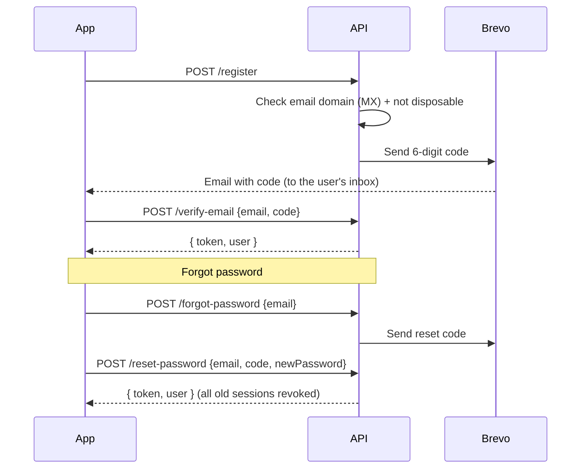

# Digital Farm Lab — API Documentation

**Version:** 1.0.0 · **Format:** JSON over HTTPS · **Server folder:** `/server`

| Environment | Base URL |
|---|---|
| Local (Neon) | `http://localhost:4000` (`npm run dev`) |
| Local (no database account) | `http://localhost:4000` (`npm run dev:local`, in-memory DB) |
| Production (Render) | `https://digital-farm-lab-api.onrender.com` *(your Render URL)* |

> Render's free plan sleeps after inactivity. The first request after a quiet period can take ~1 minute while it wakes up.

---

## 1. Conventions

### Authentication
Protected endpoints need a JWT in the `Authorization` header:

```
Authorization: Bearer <token>
```

You get a token from **verify-email**, **login**, **reset-password** or **change-password**. Tokens last 7 days (`JWT_EXPIRES_IN`). They stop working as soon as the user resets or changes their password.

Only users with a **verified email** can use protected endpoints.

### Roles
| Role | Can do |
|---|---|
| `learner` | Browse published scenarios, run simulations, submit attempts, view and compare own scores |
| `trainer` | Everything a learner can view, plus create/edit/delete own scenarios, upload images, and view learner scores for own scenarios. Trainers cannot submit attempts. |

### Error format
All errors use the same shape:

```json
{
  "error": {
    "code": "VALIDATION_ERROR",
    "message": "Please check the highlighted fields",
    "details": { "email": "Enter a valid email address" }
  }
}
```

`details` is included for validation errors. It maps each field name to a message, and the mobile app shows these under the matching inputs.

| HTTP | Common `code` values |
|---|---|
| 400 | `VALIDATION_ERROR`, `INVALID_JSON`, `CODE_INVALID`, `CODE_EXPIRED`, `CODE_LOCKED`, `EMAIL_UNDELIVERABLE`, `INVALID_TRAINER_CODE`, `INVALID_IMAGE` |
| 401 | `UNAUTHORIZED`, `TOKEN_INVALID`, `INVALID_CREDENTIALS` |
| 403 | `FORBIDDEN`, `EMAIL_NOT_VERIFIED` |
| 404 | `NOT_FOUND` |
| 409 | `EMAIL_TAKEN` |
| 429 | Too many requests (rate limit) |
| 500 | `INTERNAL_ERROR` |
| 503 | `UPLOADS_DISABLED` (Cloudinary not configured) |

### Rate limits
- All `/api/*` routes: 300 requests / minute per IP.
- `register`, `login`, `verify-email`, `resend-verification`, `forgot-password`, `reset-password`: 20 requests / 15 minutes per IP.

### Password rules
8–128 characters, with at least one letter and one number.

---

## 2. Health

### `GET /health`
```json
{ "status": "ok", "time": "2026-11-08T20:20:49.155Z" }
```
Render's health check calls this endpoint.

---

## 3. Authentication — `/api/auth`

### Account lifecycle



Codes are 6 digits and expire after **15 minutes**. A code is locked after **5 wrong attempts**. Only the newest code works. Codes are stored hashed (SHA-256), never in plain text.

### `POST /api/auth/register`
Creates an unverified account and emails a verification code.

| Field | Type | Required | Notes |
|---|---|---|---|
| `name` | string | ✓ | 2–80 chars |
| `email` | string | ✓ | Must be a real, deliverable domain. Disposable inboxes are rejected. |
| `password` | string | ✓ | See password rules |
| `role` | `"learner"` \| `"trainer"` | | Default `learner` |
| `trainerCode` | string | trainers only | Must match the server's `TRAINER_INVITE_CODE` |

**201**
```json
{ "message": "Account created. Check your email for a 6-digit code.", "email": "sipho@gmail.com" }
```
**409 `EMAIL_TAKEN`** if a *verified* account already uses that email. If an *unverified* account exists, it is overwritten so the real owner of the inbox can finish signing up.

### `POST /api/auth/verify-email`
```json
{ "email": "sipho@gmail.com", "code": "482913" }
```
**200**
```json
{
  "token": "eyJhbGciOi...",
  "user": { "id": "uuid", "name": "Sipho", "email": "sipho@gmail.com", "role": "learner", "emailVerified": true, "createdAt": "..." }
}
```
- **400 `CODE_INVALID` / `CODE_EXPIRED` / `CODE_LOCKED`**
- **409 `ALREADY_VERIFIED`**: the account is already verified. No token is returned; sign in with your password instead.

### `POST /api/auth/resend-verification`
`{ "email": "..." }` → **200** with a generic message. The reply is the same whether or not the email exists, so this endpoint can't be used to find out which emails have accounts.

### `POST /api/auth/login`
`{ "email": "...", "password": "..." }`
- **200** `{ token, user }`
- **401 `INVALID_CREDENTIALS`**
- **403 `EMAIL_NOT_VERIFIED`**: no code is sent (codes are only emailed at sign-up). The app opens the verify screen, where the user enters the sign-up code or taps "Send a new code".

### `POST /api/auth/forgot-password`
`{ "email": "..." }` → **200** with a generic message. Sends a reset code if the account exists.

### `POST /api/auth/reset-password`
```json
{ "email": "sipho@gmail.com", "code": "193847", "newPassword": "NewPass456" }
```
**200** `{ token, user }`. This also marks the email as verified, revokes all older tokens, and sends a "password changed" notice.

### `GET /api/auth/me` 🔒
**200** `{ "user": { ... } }`

### `PATCH /api/auth/me` 🔒
`{ "name": "New Name" }` → **200** `{ user }`

### `POST /api/auth/change-password` 🔒
`{ "currentPassword": "...", "newPassword": "..." }` → **200** `{ token, user }`. Other devices are signed out.

---

## 4. Reference data

### `GET /api/crops`
Public. Returns the crop, soil and cost data that the simulation engine uses.

```json
{
  "crops": [
    {
      "id": "maize", "name": "Maize", "emoji": "🌽", "seasonWeeks": 16,
      "optimalMoisture": [40, 70], "potentialYield": 8, "pricePerTon": 4200,
      "kc": { "initial": 0.4, "development": 0.8, "mid-season": 1.2, "late-season": 0.6 },
      "nitrogenNeed": 8, "pestSusceptibility": 0.7, "tips": ["..."]
    }
  ],
  "soils": [{ "id": "loam", "name": "Loam", "capacityMm": 100, "weeklyDrainage": 0.05 }],
  "costs": { "waterPerMm": 18, "fertilizerPerUnit": 650, "pestSpray": 900, "fixedPerCrop": { "maize": 6000 } },
  "irrigationOptionsMm": [0, 10, 20, 30, 40],
  "wiltingPointPct": 20,
  "waterloggingPct": 95,
  "scoreWeights": { "yield": 35, "irrigation": 20, "soil": 15, "pest": 15, "profit": 15 }
}
```

Crop IDs: `maize`, `tomato`, `wheat`, `potato`, `spinach`. Soils: `sandy`, `loam`, `clay`. Climates: `dry`, `normal`, `wet`.

---

## 5. Scenarios — `/api/scenarios` 🔒

### Scenario object
```json
{
  "id": "uuid",
  "trainerId": "uuid",
  "trainerName": "Thandi Trainer",
  "title": "Maize in a Dry Highveld Summer",
  "description": "Rain is unreliable this season...",
  "learningGoals": "Irrigation timing · drought stress",
  "crop": "maize", "cropName": "Maize", "cropEmoji": "🌽",
  "soil": "loam", "climate": "dry", "difficulty": "beginner",
  "weeks": 16,
  "avgTemperatureC": 26,
  "rainfallMm": [0, 12, 0, 5, "... one value per week"],
  "temperatureC": [28, 25, 27, "..."],
  "startMoisturePct": 55,
  "budget": 25000,
  "waterAllowanceMm": 420,
  "pestWeeks": [7],
  "imageUrl": "https://res.cloudinary.com/...", "imagePublicId": "digital-farm-lab/scenarios/<trainerId>/abc",
  "isPublished": true,
  "createdAt": "...", "updatedAt": "..."
}
```

### `GET /api/scenarios`
Query parameters (all optional): `crop`, `difficulty` (`beginner|intermediate|advanced`), `mine=true` (trainers only).

- Learners see **published** scenarios.
- Trainers see published scenarios **plus** their own drafts. With `mine=true` they see only their own.

**200** `{ "scenarios": [Scenario, ...] }`, newest first.

### `GET /api/scenarios/:id`
**200** `{ "scenario": Scenario }`. Returns 404 for drafts unless you own them.

### `GET /api/scenarios/:id/stats`
Used by learners to compare their scores with others.
```json
{
  "overall": { "attempts": 12, "average": 64.3, "best": 91.2, "averageIrrigation": 58.1 },
  "mine":    { "attempts": 3,  "average": 70.1, "best": 82.4 }
}
```

### `POST /api/scenarios` (trainer)
| Field | Type | Required | Notes |
|---|---|---|---|
| `title` | string | ✓ | 3–120 |
| `description` | string | ✓ | 10–2000 |
| `learningGoals` | string | | ≤1000 |
| `crop` | CropId | ✓ | |
| `soil` | SoilType | ✓ | |
| `climate` | Climate | ✓ | Weekly weather is generated from this |
| `difficulty` | string | | default `beginner` |
| `weeks` | int 4–30 | | defaults to the crop's season length |
| `avgTemperatureC` | number 0–45 | | default 24 |
| `startMoisturePct` | number 0–100 | | default 50 |
| `budget` | number | ✓ | Rand per hectare |
| `waterAllowanceMm` | number | ✓ | Irrigation allowance for the season |
| `pestWeeks` | int[] | | 1-based weeks, each ≤ `weeks` |
| `rainfallMm` | number[] | | Optional custom rainfall; length must equal `weeks` |
| `imageUrl`, `imagePublicId` | string \| null | | Must come from `/api/uploads/signature` |
| `isPublished` | boolean | | default `false` |

**201** `{ "scenario": Scenario }`

### `PATCH /api/scenarios/:id` (owner trainer)
Any subset of the fields above. Weather is regenerated if `climate`, `weeks`, `avgTemperatureC` or `rainfallMm` changes. If you replace the image, the old one is deleted from Cloudinary. **200** `{ scenario }`

### `DELETE /api/scenarios/:id` (owner trainer)
**204**. Also deletes all attempts and the Cloudinary image.

### `POST /api/scenarios/:id/attempts` (learner)
Submits a run. **The server re-runs the simulation engine to calculate the official score.** Scores sent by the client are never trusted. There are two modes:

**Quick experiment** (the golden journey: change one parameter of the baseline plan):
```json
{ "mode": "experiment", "params": { "irrigationChangePct": -20, "fertilizerPlan": "recommended", "plantingShiftWeeks": 0 } }
```
- `irrigationChangePct`: −100…100, % change to every irrigation in the baseline plan (−20 = 20% less water).
- `fertilizerPlan`: `none | half | recommended | double`.
- `plantingShiftWeeks`: −8…8, weeks earlier (negative) or later than the recommended planting date.
The server builds the weekly decisions from the baseline plan and these parameters.

**Week by week** (the learner made every decision):
```json
{
  "mode": "weekly",
  "decisions": [
    { "irrigationMm": 20, "fertilizer": "high", "pestControl": false },
    { "irrigationMm": 0,  "fertilizer": "none", "pestControl": false }
  ]
}
```
There must be exactly `scenario.weeks` decisions. `irrigationMm` is 0–60 and `fertilizer` is `none|low|high`. Requests without `mode` are treated as `weekly` (older app versions).

Every attempt also stores `baseline`: the headline numbers of the scenario's **baseline plan** (standard practice: irrigate to the middle of the ideal moisture band within the water allowance, recommended fertiliser, spray only in pest weeks), so results can be compared with it.

**201**
```json
{
  "attempt": {
    "id": "uuid", "scenarioId": "uuid", "learnerId": "uuid",
    "mode": "experiment",
    "params": { "irrigationChangePct": -20, "fertilizerPlan": "recommended", "plantingShiftWeeks": 0 },
    "decisions": ["..."],
    "baseline": { "totalScore": 83.3, "yieldTonsPerHa": 7.02, "waterUsedMm": 420, "totalCost": 19660, "profit": 9824 },
    "reflection": null, "reflectedAt": null, "shareToken": null,
    "totalScore": 82.4, "irrigationScore": 86.1, "yieldTonsPerHa": 7.7, "waterUsedMm": 400, "profit": 13980,
    "result": {
      "totalScore": 82.4, "grade": "A",
      "breakdown": { "yield": 96.3, "irrigation": 86.1, "soil": 100, "pest": 100, "profit": 43.3 },
      "yieldTonsPerHa": 7.7, "potentialYield": 8,
      "revenue": 32340, "totalCost": 18360, "profit": 13980, "overBudget": false,
      "waterUsedMm": 400, "waterAllowanceMm": 420,
      "weeksInOptimal": 13, "weeksBelowWilting": 0,
      "feedback": ["Excellent farm management! 🌱"],
      "logs": [{ "week": 1, "stage": "initial", "rainMm": 0, "irrigationMm": 10, "temperatureC": 28,
                 "evapotranspirationMm": 15.2, "runoffMm": 0, "moisturePct": 47.1, "cropHealthPct": 100,
                 "pestOutbreak": false, "events": [] }]
    },
    "createdAt": "..."
  }
}
```

---

## 6. Attempts — `/api/attempts` 🔒

### `GET /api/attempts/me?scenarioId=<uuid>`
The learner's own history (up to 200, newest first). `scenarioId` is optional.
```json
{ "attempts": [{ "id": "uuid", "scenarioId": "uuid", "scenarioTitle": "...", "crop": "maize", "cropEmoji": "🌽",
  "totalScore": 82.4, "irrigationScore": 86.1, "yieldTonsPerHa": 7.7, "waterUsedMm": 400, "profit": 13980, "createdAt": "..." }] }
```

### `GET /api/attempts/:id`
Full attempt, including `result.logs`, plus `scenarioTitle`, `crop`, `cropEmoji` and `learnerName`. Only the learner who made the attempt or the trainer who owns the scenario can see it. Anyone else gets 404.

### `PUT /api/attempts/:id/reflection` (the learner who made the run)
Saves answers to the reflection prompts shown after a run (1–5 answers, each at least 3 characters).
```json
{ "answers": [{ "prompt": "Why did yield change?", "answer": "Less water meant the soil dried below the ideal band." }] }
```
**200** `{ "reflection": [...], "reflectedAt": "...", "credentialEarned": true }`. `credentialEarned` is true when this reflection earned the scenario's microcredential (see below).

### `POST /api/attempts/:id/share` / `DELETE /api/attempts/:id/share` (the learner who made the run)
`POST` creates (or returns the existing) public read-only link: **200** `{ "url": "https://…/share/<token>", "token": "…" }`. `DELETE` turns the link off (**204**). The public page `GET /share/:token` needs no sign-in and shows only the learner's first name, grade, score and baseline comparison: never their email.

### `GET /api/attempts/credentials/me`
The learner's microcredentials and their AgriLearn delivery status (`pending | sent | failed`).
```json
{ "credentials": [{ "id": "uuid", "scenarioId": "uuid", "attemptId": "uuid", "scenarioTitle": "...", "crop": "maize", "cropEmoji": "🌽",
  "code": "DFL-MAIZE-7ef3cfc1", "score": 83.3, "status": "sent", "createdAt": "...", "sentAt": "..." }] }
```

---

## 6a. Virtual farm — `/api/farms` 🔒

### `GET /api/farms`
Farms → fields → scenarios on each field, each with its synthetic weekly sensor feed (soil-moisture probe from the baseline plan, rain gauge, air temperature). Learners see fields with published scenarios; trainers also see their own drafts.
```json
{ "farms": [{ "id": "uuid", "name": "Digital Farm Lab Demo Farm", "region": "Gauteng, South Africa", "isMine": false,
  "fields": [{ "id": "uuid", "name": "Field 1 · Maize", "areaHa": 1, "soil": "loam", "soilName": "Loam",
    "scenarios": [{ "id": "uuid", "title": "...", "crop": "maize", "cropEmoji": "🌽", "isPublished": true, "weeks": 16,
      "optimalMoisture": [40, 70],
      "readings": [{ "week": 1, "recordedAt": "...", "soilMoisturePct": 51.2, "rainfallMm": 0, "temperatureC": 27, "source": "synthetic" }] }] }] }] }
```

## 6b. Microcredentials → AgriLearn Passport

A learner earns a scenario's microcredential the first time a run scores at least `CREDENTIAL_MIN_SCORE` (default 70) **and** they save its reflection. The server stores a `microcredential.earned` event in the `credential_events` outbox and `POST`s it to `AGRILEARN_WEBHOOK_URL`, retrying every 10 minutes (up to 8 attempts) until AgriLearn replies 2xx. If the URL is empty, events wait in the outbox.

Headers: `X-DFL-Event-Id` (use it to ignore duplicates) and `X-DFL-Signature: sha256=<HMAC-SHA256 of the raw body with AGRILEARN_WEBHOOK_SECRET>`.
```json
{
  "id": "event-uuid", "type": "microcredential.earned", "occurredAt": "...",
  "issuer": { "name": "Digital Farm Lab", "app": "digital-farm-lab" },
  "learner": { "id": "uuid", "email": "sipho@gmail.com", "name": "Sipho", "emailVerified": true },
  "credential": { "code": "DFL-MAIZE-7ef3cfc1", "title": "Digital Farm Lab: Maize in a Dry Highveld Summer",
    "description": "...", "agrilearnModuleCode": "AGR-IRR-101", "scenarioId": "uuid", "attemptId": "uuid",
    "score": 83.3, "grade": "A", "mode": "experiment" }
}
```
Scenarios have an optional `agrilearnModuleCode` (set by the trainer) that links the credential to an AgriLearn module.

---

## 7. Trainer dashboard — `/api/trainer` 🔒 (trainer)

### `GET /api/trainer/overview`
One row per scenario the trainer owns:
```json
{ "scenarios": [{ "scenarioId": "uuid", "title": "...", "crop": "tomato", "cropEmoji": "🍅", "isPublished": true,
  "attempts": 14, "averageScore": 61.2, "bestScore": 93.4 }] }
```

### `GET /api/trainer/scores?scenarioId=<uuid>`
Every learner attempt on the trainer's scenarios (up to 500, newest first):
```json
{ "scores": [{ "attemptId": "uuid", "scenarioId": "uuid", "scenarioTitle": "...", "crop": "maize", "cropEmoji": "🌽",
  "learnerId": "uuid", "learnerName": "Sipho", "learnerEmail": "sipho@gmail.com",
  "totalScore": 82.4, "irrigationScore": 86.1, "yieldTonsPerHa": 7.7, "waterUsedMm": 400, "profit": 13980, "createdAt": "..." }] }
```

Each score row also has `mode` (`weekly | experiment`) and `reflectedAt` (null until the learner reflects).

### `GET /api/trainer/credentials`
Microcredentials earned on the trainer's scenarios and whether AgriLearn received them:
```json
{ "agrilearnConnected": true, "credentials": [{ "id": "uuid", "learnerName": "Sipho", "scenarioTitle": "...", "cropEmoji": "🌽",
  "status": "sent", "lastError": null, "createdAt": "...", "sentAt": "..." }] }
```

### `GET /api/trainer/learners?scenarioId=<uuid>`
Each learner's best score, sorted from highest to lowest:
```json
{ "learners": [{ "learnerId": "uuid", "learnerName": "Sipho", "learnerEmail": "...", "attempts": 3,
  "bestScore": 82.4, "averageScore": 70.1, "averageIrrigation": 66.0 }] }
```

---

## 8. Image uploads (Cloudinary)

### `POST /api/uploads/signature` 🔒 (trainer)
Returns a short-lived signature. The app uses it to upload the image **directly to Cloudinary**, so the free Render server never handles the image bytes.

```json
{
  "timestamp": 1762633200,
  "folder": "digital-farm-lab/scenarios/<trainerId>",
  "signature": "a1b2c3...",
  "apiKey": "123456789012345",
  "cloudName": "your-cloud",
  "uploadUrl": "https://api.cloudinary.com/v1_1/your-cloud/image/upload"
}
```

The app then sends `multipart/form-data` to `uploadUrl` with `file`, `api_key`, `timestamp`, `signature` and `folder`. Cloudinary's reply includes `secure_url` and `public_id`. Send these as `imageUrl` and `imagePublicId` when you create or update a scenario. The server only accepts images from its own Cloudinary account and the trainer's own folder.

---

## 9. Quick test with curl

```bash
API=http://localhost:4000
curl -s -X POST $API/api/auth/register -H 'content-type: application/json' \
  -d '{"name":"Sipho","email":"you@gmail.com","password":"Password123"}'
# read the code from your inbox (or from the console in dev:local mode)
TOKEN=$(curl -s -X POST $API/api/auth/verify-email -H 'content-type: application/json' \
  -d '{"email":"you@gmail.com","code":"123456"}' | node -pe 'JSON.parse(require("fs").readFileSync(0)).token')
curl -s $API/api/scenarios -H "Authorization: Bearer $TOKEN"
```
