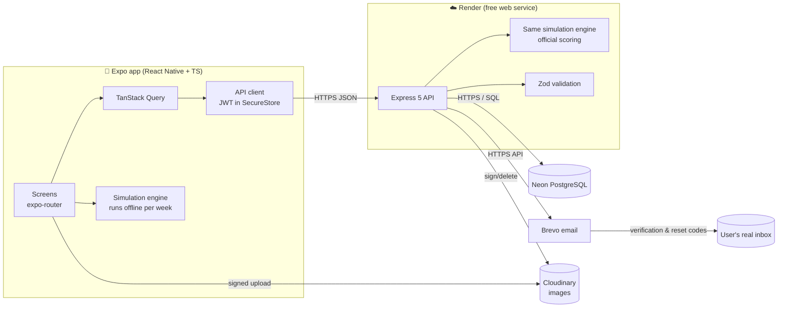
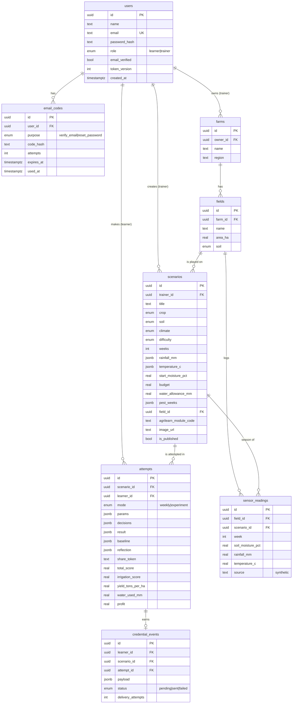

# Digital Farm Lab — System Documentation

## 1. Overview

**Digital Farm Lab** is a mobile app for learning agriculture. Learners manage a virtual farm for one growing season, week by week. Each week they decide how much to irrigate, whether to fertilize and whether to spray for pests, and they see how those choices affect soil moisture, crop health, yield and profit. Trainers create scenarios for learners and track their scores.

### Users

| Role | Main tasks |
|---|---|
| **Learner** | Sign up with a real email, browse scenarios by crop, run simulations, get a scored result with feedback, see their score history, compare two attempts side by side, and compare against the class average and top score |
| **Trainer** | Sign up with a trainer invite code, create/edit/publish/delete scenarios (with an optional photo), and see learner scores per scenario and per learner |

### Crops supported (multi-crop)
🌽 Maize · 🍅 Tomato · 🌾 Wheat · 🥔 Potato · 🥬 Spinach. Each crop has its own season length, ideal moisture band, water use per growth stage (Kc), yield, price, fertilizer need and pest susceptibility.

---

## 2. Technology stack (all free tiers, no paid services)

| Layer | Technology | Why |
|---|---|---|
| Mobile app | **React Native + Expo SDK 58**, **TypeScript** | One codebase for Android and iOS, plus web. Run it on your phone with Expo Go |
| Navigation | **Expo Router** (file-based) | Routes mirror the folder structure. Protected route groups for signed-in and signed-out users |
| Server state | **TanStack Query** | Caching, pull-to-refresh, retries and refetching after changes |
| Secure storage | **expo-secure-store** | Keeps the login token in the phone's encrypted keychain/keystore |
| Images | **expo-image-picker**, **expo-image** + **Cloudinary** | Trainers attach scenario photos. Images are uploaded directly to Cloudinary using a signed request |
| API | **Node.js 22 + Express 5**, **TypeScript** | Simple and well-known. Express 5 handles errors thrown in async route handlers |
| Validation | **Zod** | Validates every request body and query, with errors per field |
| Database | **Neon PostgreSQL** (serverless) | Free Postgres that scales to zero. Queried over HTTPS with `@neondatabase/serverless` |
| ORM / migrations | **Drizzle ORM + drizzle-kit** | Type-safe SQL and migration files kept in git |
| Email | **Brevo** HTTP API (free: 300 emails/day) | Render's free plan **blocks outbound SMTP ports**, so email has to go over an HTTPS API |
| Hosting | **Render** free web service | Deploys from GitHub using `render.yaml` |
| Security | bcryptjs, jsonwebtoken, helmet, express-rate-limit, CORS | Password hashing, sessions, security headers, brute-force protection |
| Testing | Node test runner + **PGlite** (in-memory Postgres) | Tests the full API with real SQL and no cloud account |
| App builds | **EAS Build** (optional, has a free tier) | Builds an installable Android APK. Expo Go is enough for development |

---

## 3. Architecture



### Key design decisions

1. **One shared simulation engine.** `server/src/simulation/engine.ts` and `crops.ts` are copied byte-for-byte into `mobile/src/simulation/`. The app uses the engine to run each week instantly (offline), and the server re-runs it from the learner's decisions to calculate the **official score**. This stops learners from faking scores. After editing the engine, run `npm run sync-engine` in `/server`.
2. **Email codes instead of links.** 6-digit codes work in a mobile app without setting up deep links, and getting the code proves the email inbox is real.
3. **Direct-to-Cloudinary uploads.** The server only signs the upload request. Images never pass through the free server, which has limited memory and bandwidth.
4. **Neon over HTTPS.** No connection pool to keep alive, which suits Render's free plan sleeping and Neon scaling to zero.

---

## 4. Folder structure

```
digital-farm-lab/
├── render.yaml                  # Render Blueprint (deploys /server)
├── README.md
├── docs/
│   ├── API_DOCUMENTATION.md
│   ├── SYSTEM_DOCUMENTATION.md
│   ├── PROJECT_TRACKER.md
│   └── project-tracker.csv      # same tracker, importable into Sheets/Trello
├── server/
│   ├── drizzle/                 # SQL migrations (generated)
│   ├── scripts/
│   │   ├── local-server.ts      # run API with in-memory DB (no Neon needed)
│   │   └── sync-engine.mjs      # copy engine → mobile
│   ├── src/
│   │   ├── index.ts / app.ts    # Express bootstrap
│   │   ├── config/env.ts        # validated environment variables
│   │   ├── db/                  # schema, client, seed
│   │   ├── lib/                 # jwt, email (Brevo), codes, cloudinary, email checks
│   │   ├── middleware/          # auth, validation, errors
│   │   ├── routes/              # auth, scenarios, attempts, trainer, meta
│   │   └── simulation/          # crops.ts + engine.ts (shared)
│   └── tests/                   # engine + full API tests
└── mobile/
    ├── app.json / eas.json
    └── src/
        ├── app/
        │   ├── _layout.tsx           # providers + protected routes
        │   ├── (auth)/               # welcome, login, register, verify, forgot, reset
        │   └── (app)/
        │       ├── (tabs)/           # scenarios, scores, crop guide, profile
        │       ├── scenario/[id]     # details, stats, trainer actions
        │       ├── simulate/[id]     # week-by-week simulation
        │       ├── attempt/[id]      # result + feedback + chart
        │       ├── compare           # side-by-side comparison
        │       └── trainer/          # scenario form, learner scores
        ├── api/                      # fetch client, hooks, types
        ├── auth/                     # AuthContext, token storage
        ├── components/               # UI kit, moisture chart
        ├── simulation/               # shared engine copy
        └── theme.ts
```

---

## 5. Data model



- Deleting a user deletes their codes, scenarios and attempts (cascade). Deleting a scenario deletes its attempts.
- Key score values are stored in their own columns, so the trainer dashboard can aggregate them with SQL (avg/max). The full result, including the week-by-week log, is kept in `result` (JSONB).
- **`runs` and `scores`** (named in the project spec) are read-only SQL views over `attempts`: an attempt *is* a run, and its score columns are the score.
- Each trainer gets one farm automatically; every scenario gets its own field on it. When a scenario is created or its conditions change, the server regenerates its **synthetic sensor feed** (`sensor_readings`, one row per week): the rain gauge and air temperature are the weather that drives the crop model, and the soil-moisture probe comes from the baseline plan.
- `npm run db:seed` also backfills a field + sensor feed for any scenario created before farms existed. Run it once after migrating an existing database.

---

## 6. Simulation model

A season lasts `weeks` (the crop's default length). Each week the learner chooses:

| Decision | Options | Cost (ZAR/ha) |
|---|---|---|
| Irrigation | 0, 10, 20, 30, 40 mm | R18 per mm |
| Fertilizer | none / low (1 unit) / high (2 units) | R650 per unit |
| Pest control | spray / don't spray | R900 per spray |

Every crop also has a fixed seed and land-preparation cost.

### Weekly water balance
```
ET0      = 7 × max(1, 0.17 × temperature + 0.6)        # reference evapotranspiration, mm/week
cropET   = ET0 × Kc(stage)                            # crop water use for its growth stage
water    = stored + rain + irrigation − cropET
runoff   = max(0, water − soilCapacity)               # extra water is lost
water    = clamp(water) × (1 − soilDrainage)
moisture% = water / soilCapacity × 100
```
| Soil | Capacity (mm) | Weekly drainage |
|---|---|---|
| Sandy | 60 | 12% |
| Loam | 100 | 5% |
| Clay | 140 | 2% |

### Crop health
Health starts at 100% and is multiplied by `(1 − loss)` every week:

| Condition | Weekly loss |
|---|---|
| Moisture **< 20% (wilting point)** | 10% × stage sensitivity (mid-season ×1.5) |
| Below the crop's ideal band | 2.5% × sensitivity |
| Above 95% (waterlogged) | 4% |
| Above the ideal band | 1% |
| Heat ≥ 35 °C | 3% |
| Pest outbreak not sprayed | 12% × crop pest susceptibility |

`yield = potentialYield × health × nutrientFactor × plantingFactor`, where `nutrientFactor = 0.6 + 0.4 × min(1, fertilizerApplied / cropNeed)` and `plantingFactor = 1 − 3% per week away from the recommended planting date`.

### Baseline and quick experiments (the golden journey)
The spec's purpose is *"run scenarios such as reducing irrigation by 20% and see the effect"*. Learners do that in **Quick experiment**: choose a scenario → change **one** parameter → run → see the outcome next to the baseline → receive a score.

- **Baseline** (`baselineDecisions`): standard practice at the recommended planting date. Each week it irrigates in 10 mm steps (max 40 mm, never beyond the water allowance) to aim for the middle of the crop's ideal moisture band, applies the recommended fertiliser from the development stage, and sprays only in pest weeks.
- **Parameters** (`ExperimentParams`): irrigation −40/−20/+20/+40% of every baseline irrigation · fertiliser none/half/recommended/double · planting date 2 or 4 weeks early/late.
- **Planting date** shifts the season along the scenario's weather record (reflected at the ends) and changes temperature by 0.75 °C per week (later = warmer), plus the yield factor above.
- The app previews the result instantly on the device. When saved, the server re-runs it and stores the baseline's headline numbers with the attempt, so every result (experiment or week-by-week) is shown against the baseline.

> **Calibration note:** in the dry maize starter scenario, −20% irrigation drops yield by about 70%. Water stress compounds weekly once soil falls below the 20% wilting point, so this is a strong, deliberate teaching effect, not a field-calibrated prediction.

### Scoring (total 100)

| Part | Weight | How it is calculated |
|---|---|---|
| Yield | **35%** | yield ÷ potential yield |
| **Irrigation** | **20%** | 70% × share of *well-managed* weeks (moisture in the ideal band, or too wet while the learner correctly didn't irrigate) + 30% × water efficiency (irrigation not lost as runoff) − % over the water allowance − 5 points per week below 20% |
| Soil & nutrients | 15% | Correct fertilizer amount (too little or more than 130% of need is penalised), −10 per week the learner irrigated a waterlogged field |
| Pest management | 15% | Share of outbreaks controlled − 10 per unnecessary spray |
| Profit | 15% | Profit ÷ best possible profit, −25 if over budget |

Grades: **A** ≥ 80 · **B** ≥ 70 · **C** ≥ 60 · **D** ≥ 50 · **F** below 50. Each result includes plain-language feedback on what to improve.

> **About "irrigation with 20%":** the app uses 20% in two ways that support each other. Irrigation makes up **20% of the total score**, and **20% soil moisture is the wilting point** that causes the heaviest crop damage. Both are constants (`SCORE_WEIGHTS.irrigation`, `WILTING_POINT_PCT`) and can be changed in one place.

### Weather
Trainers pick a climate (dry/normal/wet) and an average temperature. The server generates weekly rainfall and temperatures from a seeded random generator, so every learner gets **identical weather** for a scenario and scores can be compared fairly. Learners see each week's forecast before they decide.

Values are simplified for teaching (loosely based on FAO-56 crop coefficients and typical South African yields and prices). They are not agronomic advice.

### Model simplifications (shown in the app)
The app shows a **"Teaching model – not agronomic advice"** notice on the Crop Guide tab, the quick-experiment screen and every result. It lists the simplifications (`MODEL_SIMPLIFICATIONS` in `crops.ts`):
- One hectare, one crop and one uniform soil layer; no slopes, shade or field variation.
- Weather and sensor readings are synthetic (generated), not measured on a real farm.
- Water use is a weekly bucket model loosely based on FAO-56 crop coefficients.
- Nutrients are a single "fertilizer units" number; no N, P, K or soil chemistry.
- Pests arrive on fixed weeks and one spray always controls them.
- Prices and costs are fixed teaching values in rand, not live market prices.
- Planting date only shifts temperature and the weather window, plus a small yield penalty.

### Reflection, sharing and microcredentials
- After each run the learner answers **three reflection prompts** tailored to what they changed (why it happened, whether the trade-off was worth it, what a real farmer would still need to check). Trainers can read the answers.
- Learners can **share a result** as a public read-only link (`/share/<token>`) that shows first name, grade and the baseline comparison, never their email. They can switch the link off.
- A scored run of **70+ plus a completed reflection** earns the scenario's **microcredential**, sent to the AgriLearn Passport as a signed webhook event (API docs §6b).

---

## 7. Security

| Concern | Measure |
|---|---|
| Real emails only | Email format check → disposable-domain blocklist → **DNS MX lookup** (the domain must accept mail) → **6-digit code sent to the inbox**. The account can't be used until it is verified. |
| Account recovery | Forgot-password sends a code by email. A reset revokes all existing sessions (`token_version`) and sends a "password changed" notice. |
| Passwords | bcrypt (cost 12). Minimum 8 characters with a letter and a number. |
| Codes | Random 6 digits, SHA-256 hashed, 15-minute expiry, max 5 attempts, only the newest code is valid, compared in constant time. |
| Account enumeration | Forgot-password and resend-verification give the same reply whether or not the email exists. |
| Brute force | Strict rate limit on auth routes (20 per 15 min) and a global API limit. |
| Sessions | JWT (7 days) stored in SecureStore on the phone. Each request is checked against the user's current `token_version`. |
| Trainer role | Registering as a trainer requires `TRAINER_INVITE_CODE`. |
| Authorisation | Trainers can only edit their own scenarios and only see scores for their own scenarios. Learners only see their own attempts. Drafts are hidden from learners. |
| Score integrity | The server recalculates every score from the submitted decisions. |
| Uploads | Signed, folder-scoped Cloudinary uploads. The server rejects image URLs from other accounts or folders. |
| Headers / input | helmet, a 200 KB JSON limit, and Zod validation on all inputs. |

---

## 8. Setup & deployment guide

### 8.1 Prerequisites
- Node.js 20+ (22 recommended), Git, a GitHub account
- The **Expo Go** app on your Android or iOS phone
- Free accounts: **Neon**, **Render**, **Brevo**, **Cloudinary** (and optionally **Expo/EAS**)

### 8.2 Run everything locally in 2 minutes (no accounts)
```bash
cd server && npm install
EMAIL_DNS_CHECK=false npm run dev:local    # in-memory DB, seeded scenarios, codes printed in the console
```
```bash
cd mobile && npm install
cp .env.example .env    # set EXPO_PUBLIC_API_URL=http://<your-computer-LAN-IP>:4000
npx expo start          # scan the QR code with Expo Go
```
Trainer invite code in local mode: `FARM-TRAINER-2026`. Verification codes appear in the server console as `[DEV EMAIL]`.
Local mode also creates two ready-to-use, already-verified accounts (password `Demo1234`): `learner@demo.test` and `trainer@demo.test`. Data is lost when the server stops.

**Web / PWA:** `npx expo start --web` runs the app in a browser. For an installable PWA, build it with `npx expo export -p web` and host the `dist/` folder on any static host (e.g. Render Static Site, free). The service worker (`public/sw.js`) and manifest (`public/manifest.json`) are only active in that production build. Scenarios, the farm view and your results are saved on the device (7 days) so the app opens offline; saving a new score needs a connection.

### 8.3 Neon (database)
1. Create a project at neon.tech and copy the **pooled** connection string.
2. Put it in `server/.env` as `DATABASE_URL`.
3. Run `npm run db:migrate` (creates the tables) and then `npm run db:seed` (adds 5 starter scenarios, one per crop).

### 8.4 Brevo (emails)
1. Sign up at brevo.com → **Senders, Domains & Dedicated IPs → Senders** → add and verify your sender email (a Gmail address works).
2. **SMTP & API → API Keys** → create a key → `BREVO_API_KEY`.
3. Set `EMAIL_FROM_ADDRESS` to the verified sender.
4. Tip: emails sent from a free mailbox (e.g. Gmail) can land in spam. If you later get a domain, verify it in Brevo (SPF/DKIM) for better delivery.

### 8.5 Cloudinary (images)
Dashboard → copy **Cloud name**, **API key** and **API secret** into `CLOUDINARY_*`. Uploads go to the `digital-farm-lab/scenarios/<trainerId>/` folder.

### 8.6 Render (API hosting)
1. Push the repository to GitHub.
2. Render → **New → Blueprint** → choose the repo. `render.yaml` sets up the service with `rootDir: server`, the free plan and a `/health` check.
3. Enter the secret values when prompted: `DATABASE_URL`, `TRAINER_INVITE_CODE`, `BREVO_API_KEY`, `EMAIL_FROM_ADDRESS`, `CLOUDINARY_*`. `JWT_SECRET` is generated automatically.
4. Every deploy runs `npm run build && npm run db:migrate`.
5. Run the seed once from your computer, pointed at Neon: `npm run db:seed`. **Run it again after deploying the farms update**: it backfills a field and sensor feed for existing scenarios.
6. Set `PUBLIC_BASE_URL` to the Render URL so share links point to it. Set `AGRILEARN_WEBHOOK_URL` once AgriLearn gives you an endpoint, and give them the generated `AGRILEARN_WEBHOOK_SECRET` so they can check signatures.

### 8.7 Mobile app
- Development: `npx expo start` with `EXPO_PUBLIC_API_URL` set to your Render URL or LAN IP.
- Installable Android APK (optional, uses EAS's free tier): `npm i -g eas-cli && eas login && eas build -p android --profile preview`. First update the Render URL in `eas.json`.

### 8.8 Environment variables (server)
| Variable | Required | Description |
|---|---|---|
| `DATABASE_URL` | ✓ | Neon pooled connection string |
| `JWT_SECRET` | ✓ | ≥32 random characters |
| `JWT_EXPIRES_IN` | | default `186d` |
| `TRAINER_INVITE_CODE` | ✓ | Code needed to register as a trainer |
| `BREVO_API_KEY` | ✓ (prod) | If empty, emails are printed to the console |
| `EMAIL_FROM_ADDRESS` | ✓ | Brevo-verified sender |
| `EMAIL_FROM_NAME` | | default `Digital Farm Lab` |
| `EMAIL_DEV_LOG_ONLY` | | `true` = print emails instead of sending |
| `EMAIL_DNS_CHECK` | | default `true`. Set `false` only for offline development |
| `CLOUDINARY_CLOUD_NAME` / `_API_KEY` / `_API_SECRET` | for images | If missing, uploads return 503 and scenarios work without images |
| `CLOUDINARY_FOLDER` | | default `digital-farm-lab` |
| `CORS_ORIGINS` | | `*` or a comma-separated list (only matters for the web build) |
| `PORT` | | default 4000 (Render sets this) |
| `AGRILEARN_WEBHOOK_URL` | | AgriLearn Passport endpoint for microcredential events. Empty = events wait in the outbox |
| `AGRILEARN_WEBHOOK_SECRET` | with webhook | Signs each event (`X-DFL-Signature`, HMAC-SHA256) |
| `CREDENTIAL_MIN_SCORE` | | default `70`: minimum score (with a reflection) to earn a microcredential |
| `PUBLIC_BASE_URL` | | Public API URL used in share links; default = the request's host |

Mobile: `EXPO_PUBLIC_API_URL`.

---

## 9. Testing & quality

| Check | Command | What it covers |
|---|---|---|
| Engine tests | `cd server && npm test` | Weather is deterministic, every crop rewards good management over neglect, irrigation counts for 20%, over-irrigation is penalised, every crop's baseline scores ≥ 60 within its water allowance, −20% irrigation uses 20% less water, fertiliser and planting date change the outcome |
| API end-to-end test | (same command) | Register → wrong code rejected → verify (no token for already-verified accounts) → trainer invite code → create scenario → partial update keeps other settings → publish → farm, field and 16-week sensor feed → quick experiment with baseline → weekly attempts → reflection → signed microcredential to a fake AgriLearn → share link (first name only, can be switched off) → stats → trainer scores → password reset revokes old token → delete (field removed). Runs on in-memory Postgres (PGlite) |
| Type checks | `npm run typecheck` in `/server` and `/mobile` | Strict TypeScript |
| Bundle check | `npx expo export --platform android` | The app bundles cleanly with Metro |

Before delivery, the full flow (learner sign-up → simulation → result → compare; trainer sign-up → create scenario) was also clicked through in a browser at phone size, with no console errors.

---

## 10. Known limitations & future work
- Render's free plan sleeps after inactivity, so the first request can be slow. The app's error message mentions this.
- Engine copies must be kept in sync by hand (`npm run sync-engine`). An npm workspace or shared package would make this automatic.
- Weather is generated, not real historical data. A future version could load real rainfall for a chosen town.
- AgriLearn integration is built as a signed webhook with an outbox, because AgriLearn's API wasn't available. Confirm the endpoint, payload and identity matching (currently by verified email) with the AgriLearn team. The app has its own login, not AgriLearn single sign-on.
- Offline: saved data can be viewed and experiments previewed offline, but scores are not queued; saving a run needs a connection.
- Possible next features: classes with join codes, CSV export of scores, push notifications (Expo Notifications is free), offline queue for attempts, more crops and languages (isiZulu, Afrikaans, Sesotho), dark mode, admin role.
